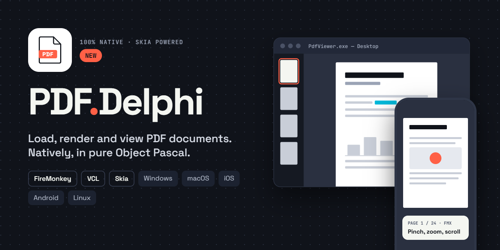
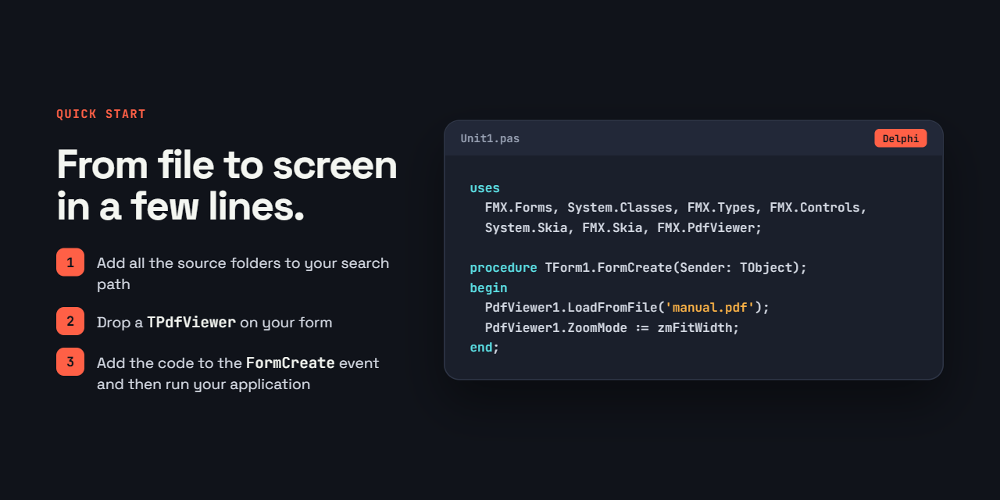

<p align="center">
  
</p>

# PDF.Delphi

**PDF.Delphi — PDF rendering, 100% Delphi.** No wrappers.

PDF.Delphi is a complete PDF engine written in pure Object Pascal (parser, fonts, decoders and renderer), compiled straight into your app with no third-party PDF libraries.
Drop `TPdfViewer` on a form, call `LoadFromFile`, and you're done: zoom, search, text selection, links, bookmarks and thumbnails included.
One engine, two frameworks: the same component for **VCL** and **FMX**, on every platform FMX supports.

<a href="https://github.com/sponsors/Spelt"></a>

<sub>pdf.js (Apache 2.0) served as the reference for structure and edge cases; see `NOTICE`.</sub>

## Requirements

- Delphi 13.x with the bundled Skia (`System.Skia`, `FMX.Skia`,
  `Vcl.Skia`). `Pdf.Core` and `Pdf.Font` use only the RTL and compile for
  every platform; `Pdf.Render` and the framework-independent viewer logic
  (`Pdf.Viewer.*`) add `System.Skia`; only `FMX.Pdf*` depends on FMX and only
  `Vcl.Pdf*` on the VCL.
- Tests: DUnitX as shipped with Delphi (`$(BDS)\source\DUnitX`).

It wil probably also work for Delphi 11 and 12 but you need to use Unit aliasing because the names of the used Skia units are different.


## Quick start

<p align="center">
  
</p>

## Components installation
In Packages open the projectgroup PdfDelphi. Then: 
- For FMX: Build `PdfViewerFMX`, then install
- For VCL: Build `PdfViewerVCL`, then install

This wil get `TPdfViewer` and `TPdfThumbnails` on
the "PDF" palette page, or create the viewer in code:

```pascal
uses FMX.PdfViewer;

Viewer := TPdfViewer.Create(Self);
Viewer.Parent := Self;
Viewer.Align := TAlignLayout.Client;
Viewer.ZoomMode := zmFitWidth;             // or zmFitPage, or Zoom := 1.5
Viewer.OnPageChange := ViewerPageChange;   // (Sender; PageIndex: Integer)
Viewer.LoadFromFile('brochure.pdf');       // optioneel password as 2e parameter
Viewer.GoToPage(3);
```

Pages are rendered at `Zoom x screen scale` on a background thread; the UI
thread only draws finished `ISkImage`s and shows the nearest cached rendition
scaled while a sharp one is pending. `CacheLimitMB` bounds the memory
(256 MB by default, 96 MB on mobile). `RenderPageToImage(Index, Scale)`
returns a page as an image for thumbnails or export.

Further viewer features:

- Layout: `DisplayMode` chooses continuous or one-row-at-a-time scrolling,
  with single or facing pages (`FacingCoverPage` keeps the first page alone);
  `Rotation` (0, 90, 180, 270) rotates the whole view on top of each page's
  own `/Rotate`. `RowPages` returns the pages shown side by side.
- Encrypted files: `OnPasswordRequest` asks the application for a password
  and retries; without a handler the load fails with `EPdfPasswordError`.
- Companion controls: `AddChangeListener` reports document, page, zoom,
  scroll, rotation, layout, selection, search and rendered-image changes;
  `RequestPageImage` / `TryGetPageImage` render through the viewer's own
  background queue and cache. `TPdfThumbnails` (`FMX.PdfThumbnails`) uses
  these for a thumbnail strip that follows and navigates a `TPdfViewer`.
- Links: clicks follow GoTo destinations and Named actions directly; URIs go
  to `OnOpenURI` (the control never launches a browser itself). `OnLinkClick`
  can intercept any action.
- Bookmarks: `Outline` (a tree of `TPdfOutlineItem`), `GoToOutlineItem`,
  `GoToDestination`; all navigation data is available through `Navigation`.
- Text: dragging over text selects it (double-click a word, Ctrl+A the page),
  Ctrl+C copies, `SelectedText`; `Find(text)` highlights every match in the
  document, `FindNext`/`FindPrevious` (F3 / Shift+F3) jump to them, Esc
  clears. `TextPage(Index)` returns the extracted text with glyph positions.
  Text extraction briefly pauses the render thread, because the object model
  is not thread-safe. `SearchMatch(I)` and `GoToMatch(I)` expose the results
  for a result list.
- Touch (Android, iOS): a finger always scrolls, also over text, with the
  platform's momentum through FMX's `TAniCalculations` (`KineticScrolling`,
  FMX only); pinch zoom scales the page smoothly and renders it sharp when
  the fingers lift.
- Input: mouse wheel scrolls (Ctrl+wheel zooms, Shift+wheel scrolls
  horizontally), drag pans, pinch and double-tap zoom on touch devices,
  keyboard navigation with the arrow, page and home/end keys, `+`/`-`/`0`.


## Demo

`DemoFMX\PdfViewerDemo.dproj` is a complete desktop viewer built on the two controls,
with everything placed at design time: an icon toolbar with page field and
zoom slider, a sidebar with thumbnails, bookmarks, search results and
document properties, a status bar, light and dark theme (the dark theme is
the `Dark.style` that ships with Delphi, embedded as a resource), drag and
drop, recent files, rotation and page-layout modes, PNG export, clipboard
(page image and text), printing, a password prompt and a keyboard-shortcut
overlay (F1). Settings persist in `%APPDATA%\PdfViewerDemo\settings.ini`.

`DemoVCL\PdfViewerVclDemo.dproj` is a small VCL counterpart: a toolbar
(open, page navigation, zoom, fit width/page, rotate, search), a thumbnail
strip and the viewer, placed at design time (install `PdfViewerVCLDsgn`
first). Files open from the button, Ctrl+O, drag and drop or the command
line.

`DemoMobile\PdfViewerMobileDemo.dproj` is a minimal FMX demo for Android and
iOS (it also runs on Windows): it opens the sample `test.pdf`, embedded as a
resource so that nothing has to be deployed, with pinch to zoom, double tap,
dragging, a fit-width button and previous/next page buttons.

For performance on mobile devices, the demo switches FMX to the Skia canvas
with the GPU back ends before the application starts (in the `.dpr`, with
`FMX.Types` and `FMX.Skia` in the uses clause). The same settings can help in
your own apps:

```pascal
GlobalUseSkia := True;   // FMX draws through Skia
GlobalUseMetal := True;  // GPU rendering with Metal on iOS and macOS
GlobalUseVulkan := True; // GPU rendering with Vulkan on Android
```


## PDF.Delphi
PDF.Delphi is released under the Apache 2.0 license.
A copy of the Apache 2.0 license can be found here: http://www.apache.org/licenses/LICENSE-2.0